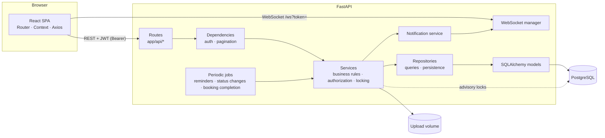

# Architecture



## Layering (strictly one-directional)

```
Routes  ->  Dependencies  ->  Services  ->  Repositories  ->  Models  ->  PostgreSQL
```

* **Routes** (`app/api`) parse/validate input (Pydantic), call one service function, shape the response. No business logic.
* **Dependencies** (`app/api/deps.py`) authenticate the bearer token, load the user, provide pagination.
* **Services** (`app/services`) hold every rule: authorization (`permissions.py`), status machines, capacity/waitlist, overlap detection, file validation, notifications, auditing.
* **Repositories** (`app/repositories`) build queries (filters, search, sort, pagination) and persist; they know nothing about users or rules.
* **Models** (`app/models`) are the SQLAlchemy schema.

## Authorization model

1. **Organization level** – `require_role(db, user, org_id, min_role)`; non-members get `403 ORGANIZATION_ACCESS_DENIED`. Cross-tenant IDs on nested routes are answered with 404.
2. **Role level** – hierarchy `participant < staff < event_manager < org_admin`; super admins act as org admin everywhere.
3. **Resource/object level** – event managers may only modify events they organize (`EVENT_ACCESS_DENIED`); participants only see their own registrations/files/attendance; draft events are invisible to participants; only requester or admin can change a booking.

## Concurrency

Critical sections (registration capacity, waitlist promotion, booking/session overlap checks) run under `locked(db, key)`:

* **PostgreSQL** – `pg_advisory_xact_lock(hash(key))`, held until the transaction commits. Check-then-insert is therefore atomic per event / resource / organization schedule.
* **Defence in depth** – partial unique index on active registrations and gist exclusion constraints on bookings and room sessions; an `IntegrityError` is translated to the same domain error (`DUPLICATE_REGISTRATION`, `RESOURCE_ALREADY_BOOKED`).
* Tests use SQLite with an in-process mutex of the same shape and fire 8 simultaneous requests.

## Auth tokens

Short-lived access JWT (15 min) + refresh JWT (7 days) whose SHA-256 hash is stored. Every refresh **rotates** the token; presenting an already-rotated token revokes all of that user's sessions (`TOKEN_REUSED`). Changing the password revokes all refresh tokens. Inactive users fail at login, at refresh and on every authenticated request.

## Real-time

`/ws?token=<access>` — the server pushes `{event, data}` JSON: `notification`, `registration.created|updated|approved`, `booking.requested|approved|rejected`, `event.cancelled|updated`, `attendance.updated`, `comment.created`. The SPA reconnects automatically and re-fetches affected lists; all data is also available through the REST endpoints (polling fallback: `GET /api/notifications`, `/unread-count`).

## Background processing

* In-process scheduler (`app/services/jobs.py`, every `SCHEDULER_INTERVAL_SECONDS`): event reminders (`EVENT_STARTING_SOON`, once per event), auto status `published→ongoing→completed`, `approved→completed` bookings.
* Waitlist promotion happens transactionally inside the cancel/reject/capacity-change request (so it can't be lost); notifications and WebSocket pushes are emitted after commit.
* `send_email` is a logging stub — plug SMTP/SES in there. To scale out, run `jobs.run_all` from Celery beat and swap the WebSocket manager for Redis pub/sub.
